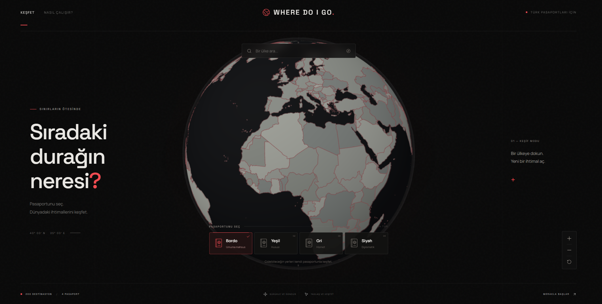

# Where Do I Go

An interactive travel explorer for Turkish passport holders. Choose a country on the 3D globe and select your passport type to view visa requirements, permitted stay durations, entry conditions and a short country summary.

**[Visit the live site](https://www.wheredoigo.com.tr)**

## Technologies

- **Backend:** Java 21, Spring Boot, Spring JDBC, Jsoup.
- **Database:** PostgreSQL, Flyway.
- **Frontend:** React, Three.js, Vite.
- **Testing:** JUnit, Playwright.
